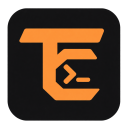
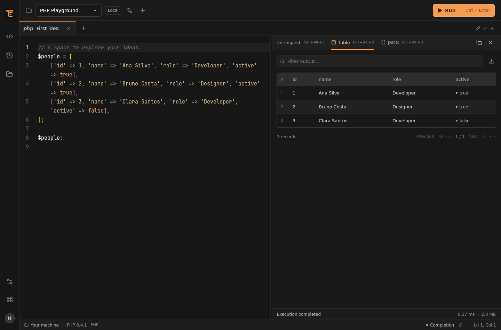

<p align="center">
  
</p>

# TinkerCraft

**A desktop PHP playground for your Laravel projects.**

Write a snippet, run it in the context of your application, and explore the result. TinkerCraft brings a focused editor, PHP completion, local and remote execution, and structured output into one Linux desktop app.

Inspired by [Tinkerwell](https://tinkerwell.app), TinkerCraft is an independent open-source implementation. It is not affiliated with, endorsed by, or maintained by Beyond Code. No proprietary Tinkerwell source code or assets are included.

> **Early-stage software.** Linux is the current target. Expect rough edges across different PHP runtimes, framework versions, and desktop environments.



## What you can do

- **Write PHP comfortably.** Monaco editor, automatic completion, hover information, signature help, and diagnostics through Phpactor. PHP opening and closing tags are optional in the editor.
- **Format your snippets.** Press **Alt+Shift+F**, use the editor button, or find **Format PHP code** in the command palette. Formatting runs offline, supports undo, and never executes your PHP. Customize the style or import JSON rules in **Preferences → Formatting**.
- **Work in your application's context.** Bootstrap Laravel or Composer, use plain PHP, or provide a custom bootstrap file.
- **Run where your project lives.** Local PHP, local Docker containers, SSH servers, and Docker containers over SSH.
- **Read the result.** Expand arrays and objects, inspect Eloquent models and Collections, switch to JSON or a table, and export the inspected data as CSV.
- **Focus on your code.** Hide or restore the output panel with **Ctrl+J**. Closing the panel preserves results and its current view; running a snippet opens it again.
- **Keep your snippets.** Rename tabs, restore them after restarting, save PHP files, and revisit execution history.
- **Stay on the keyboard.** A command palette, remappable shortcuts, and shortcut hints throughout the interface.
- **Complete remote code locally.** A selective source cache supports remote completion and expires after inactivity; it does not upload changes to your project.

## A small example

Select a Laravel connection and run:

```php
collect([
    ['name' => 'Ana', 'active' => true],
    ['name' => 'Bruno', 'active' => false],
])->where('active', true)->values();
```

TinkerCraft returns the last expression, so an explicit `return` is usually unnecessary. `dump()` and `dd()` also produce structured output. Database queries use the application's actual connection and permissions.

## Install on Linux

The initial distribution format is a Debian `.deb` package with a desktop entry and application icons. Packages include Phpactor; a **local PHP 8.2+ CLI** is still required for parsing and language support, even when execution happens remotely.

| Package variant | Initial target |
| --- | --- |
| `linux-amd64-webkit40` | Ubuntu / Pop!_OS 22.04, x86-64 |
| `linux-amd64-webkit41` | Ubuntu 24.04, x86-64; release build configured, runtime validation pending |

1. Open [Releases](https://github.com/Henriquex25/TinkerCraft/releases) and download the `.deb` matching your system in the table above. The **Source code** archives are for contributors.
2. Double-click the downloaded `.deb`, choose **Install** in your Linux package installer, and authorize installation. It resolves GTK/WebKit and updater dependencies from your distribution's repositories.
3. Open **TinkerCraft** from the application menu.

**You do not need Go, Node.js, npm, Wails, development headers, an `.env` file, or the build scripts to install a published package.** Phpactor and the update repository are already included. A local PHP 8.2+ CLI remains required for parsing and language support.

If your desktop has no graphical package installer, install the downloaded file with `sudo apt install ./tinkercraft_<version>_<variant>.deb`, replacing the placeholders with its actual filename.

Open **TinkerCraft** from your application menu. Configure an absolute PHP path in Preferences if your desktop session cannot find it. A startup invitation announces updates; choose **Update** to download, verify, authorize installation through Linux, and reopen with your tabs restored. **Remind me later** keeps the footer indicator. If the update is already installed on disk, the same **Update** button restarts directly without reinstalling it. Updates never install on startup or without your action.

## For contributors: build from source

Skip this section if you installed a published `.deb`. These commands are for developing or compiling TinkerCraft yourself.

<details>
<summary>Show source build requirements and commands</summary>

You need Go, Node.js 22.12+, PHP 8.2+, and GTK3 / WebKit2GTK development packages. Go 1.27.3 and PHP 8.4 are used in CI. On Ubuntu / Pop!_OS 22.04:

```bash
sudo apt install build-essential pkg-config libgtk-3-dev libwebkit2gtk-4.0-dev \
  python3-gi gir1.2-gdkpixbuf-2.0 dpkg-dev desktop-file-utils

npm --prefix frontend ci
go install github.com/wailsapp/wails/v2/cmd/wails@v2.15.0
./scripts/install-phpactor.sh
./scripts/build.sh
./scripts/start.sh
```

On Ubuntu 24.04, use `libwebkit2gtk-4.1-dev` instead. The build selects the installed WebKit variant; `TINKERCRAFT_WEBKIT=4.0` or `4.1` overrides the selection. Build a `.deb` with `./scripts/package-linux.sh`. The application version comes only from the root `VERSION` file and is embedded in the desktop executable. Private npm manifests intentionally omit an application version.

The Phpactor installer verifies the pinned checksum **before executing the download**. Settings, tabs, and history are stored locally in `~/.config/tinkercraft`, with compatibility for earlier Lume workspaces. Set `TINKERCRAFT_DATA_DIR` to use an isolated workspace.

</details>

Official installers manage Phpactor and the update repository internally. These components are not editable in Preferences; legacy overrides are ignored. You can configure the installed local PHP executable, cache retention, language, keyboard shortcuts, formatting, and startup update checks.

## Connect a project

1. Create a connection and choose Local, Docker, SSH, or SSH + Docker.
2. Set the project path **inside the selected environment**. For Docker, choose the PHP container and use **Detect directory** if needed.
3. Test and save the connection. Completion uses the local sources, an accessible bind mount, or an automatically prepared source cache.
4. Write PHP and press **Ctrl+Enter**. Open the command palette with **Ctrl+Shift+P** or **F1**.

SSH uses your OpenSSH configuration, keys, and agent. Verify the server's host key from a terminal first. Password prompts are not supported; encrypted keys must be available through your SSH agent. Docker containers must already be running and contain PHP CLI.

English is the default interface language. Choose **Preferences → General → Language** to switch to Brazilian Portuguese. The choice persists across restarts and also translates the editor's built-in controls. Your code, connection names, and execution results retain their original content. See the [detailed usage guide](docs/usage.pt-BR.md) and [packaging and updates guide](docs/releases.md).

## Execution and security

Snippets run with the real permissions of the selected PHP process. **There is no code sandbox, database rollback, or read-only execution mode.** Each execution starts a new process; variables do not persist between runs. Cancelling SSH or Docker transport does not guarantee that remote work has stopped.

Only select trusted local projects: their Phpactor configuration and Composer integration may execute project code during language analysis. Automatically cached remote sources use generated JSON-based autoload maps instead of executing remote PHP loaders on your computer.

Output and CSV exports reflect the inspected data, including any truncation limits. Tabs and history can contain secrets and are stored locally without encryption. Read [SECURITY.md](SECURITY.md) for the trust model, update integrity limits, and reporting guidance.

## Contributing

Issues, focused pull requests, and reproducible bug reports are welcome. Start with [CONTRIBUTING.md](CONTRIBUTING.md).

For questions and ideas, see [Support](SUPPORT.md) and the [community conduct guidelines](CODE_OF_CONDUCT.md). Repository owners can follow the [GitHub maintainer guide](docs/github-maintainer.md) to configure community workflows and publish app updates.

At startup, a small invitation lets you support the project with a GitHub star. Both **No, thanks** and **Star on GitHub** permanently dismiss it in your local workspace. The latter opens the repository in your browser, where you can choose to star it; the app does not access your GitHub account. Both actions are also available in the command palette while the invitation is visible.

You can also [buy me a coffee](https://www.buymeacoffee.com/henriquemiranda) to support continued development. The link is available in **About and updates** and the command palette. A separate, dismissible invitation may appear from the fifth app launch, after you have run a snippet and answered the star invitation in an earlier session. Both responses dismiss it permanently. Launch counting stays local and stops at five; language reloads do not count as new launches. Donations are optional and do not unlock features.

CI is configured to run on pull requests and pushes: Go tests with race detection and coverage, static checks, frontend compilation, rendering and CSV tests, Laravel and Phpactor integration, WebKit workflows, native Wails tests, and dependency audits. These checks reduce regression risk; they do not prove that every environment or change is safe. Maintainers should require the **Linux checks** status before merging.

Architecture: **Wails 2 + Go + React / TypeScript + Monaco + Phpactor**. The editor uses Monaco's public editor APIs; TinkerCraft does not maintain a fork of VS Code.

## License and acknowledgements

TinkerCraft's own code is licensed under [MIT](LICENSE). Third-party dependencies retain their original licenses; see [THIRD_PARTY_NOTICES.md](THIRD_PARTY_NOTICES.md).

Thank you to the maintainers of Wails, Monaco Editor, Phpactor, PHP-Parser, React, and Laravel. Tinkerwell and Beyond Code remain the names of their respective owners; the inspiration credit does not imply permission, affiliation, or endorsement.
