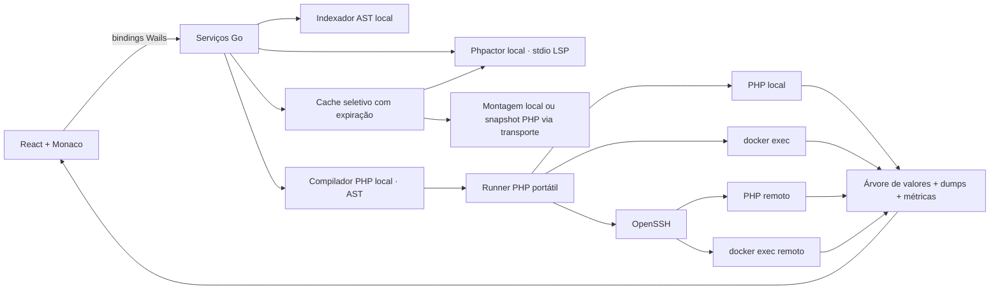

# Decisão de arquitetura

## Wails + Go + React + Monaco

A primeira versão é uma ferramenta pessoal de execução de PHP/Laravel em Linux. Não precisa de explorador completo de arquivos, extensão de VS Code ou extension host. O editor Monaco fornece a edição; o servidor de linguagem fornece a inteligência PHP; Go controla os processos e os transportes.

| Opção | Vantagens para este produto | Custo/limite | Decisão |
| --- | --- | --- | --- |
| Wails + Go + React | Backend de processos em Go, WebView do sistema, assets embutidos, sem distribuir Chromium | Variações de WebKitGTK exigem teste no Linux alvo | Escolhida |
| Electron + React | Chromium previsível, ecossistema de editores, boa integração com Monaco | Runtime e distribuição maiores; backend precisaria ser Node ou um processo Go adicional | Alternativa se a validação WebKit revelar problemas relevantes |
| Fork de Code OSS | Workbench completo e arquitetura de extensões | Grande superfície de manutenção para uma ferramenta focada em snippets | Não necessário para o escopo |
| Tauri + React | WebView do sistema e runtime compacto | Acrescentaria Rust sem resolver a dependência de WebKit no Linux | Sem vantagem suficiente neste projeto |

Não foram feitos benchmarks comparativos de RAM, latência ou consumo de CPU entre as stacks. A escolha considera o escopo e o ambiente disponível, não uma alegação de superioridade medida.

Wails 2.15 foi a versão disponível no cache e compilou com GTK3/WebKit2GTK 4.0 da máquina. A documentação atual do Wails 3 exige GTK4/WebKitGTK 6.0 por padrão; a opção GTK3 exige WebKit2GTK 4.1, também ausente aqui. A versão 2 recebe manutenção separada. Há releases 2.x posteriores à versão usada; a atualização deve ser feita com acesso de download e validada antes de distribuir o aplicativo. [Wails 2 build](https://v2.wails.io/docs/v2.15.0/gettingstarted/building/), [Wails 3 requisitos](https://wails.io/quick-start/installation/), [changelog Wails 2](https://v2.wails.io/changelog/).

## Fronteiras

### Execução

1. O compilador local usa o parser aberto `nikic/php-parser` apenas para analisar o trecho.
2. Se a última instrução for uma expressão, insere `return` na posição indicada pela AST. Mantém comentários, espaços e linhas do código original. O trecho original nunca é avaliado durante a compilação.
3. O Go inicia `php -r <runner>` com o código e a configuração como JSON por stdin.
4. Em Docker, envolve em `docker exec -i --workdir`; em SSH, usa OpenSSH com argumentos próprios e um comando remoto com cada argumento escapado para shell POSIX.
5. O runner faz `chdir`, carrega o bootstrap, intercepta VarDumper, executa o código e inspeciona o resultado.
6. Um marcador aleatório por execução delimita um envelope JSON/base64; texto escrito diretamente em stdout é mantido separado.

O runner não usa daemon remoto, PTY, arquivo temporário no repositório ou pacote Composer instalado pelo TinkerCraft. Uma nova execução inicia um processo independente.

### Editor e linguagem

Cada aba tem um model Monaco e, quando ativa, uma sessão de linguagem. O documento LSP tem URI de um arquivo virtual dentro do diretório do projeto, sem gravá-lo no repositório. A ponte implementa framing `Content-Length`, inicialização, sincronização completa de texto, completion/resolve, hover, assinaturas, diagnósticos, cancelamento de requests e respostas a requests do servidor.

O usuário escreve o corpo do PHP sem tags. A linguagem Monaco `tinkercraft-php` reutiliza a gramática PHP vendorizada com estado inicial `phpRoot`, evitando realce como HTML e a sobrescrita pela gramática padrão carregada de forma tardia. A ponte LSP insere `<?php` internamente e compensa as linhas nas posições/edições/diagnósticos. Importações e abas persistidas são normalizadas; exportações `.php` incluem abertura válida.

O editor usa Monaco 0.57.0 oficial via ESM, com imports estáticos, contribuições selecionadas e worker `?worker&inline` para a origem `wails://`. O CSS é carregado pelo bundle inicial. O Vite substitui o DOMPurify interno pela dependência corrigida 3.4.17 e rejeita builds que incluam a cópia antiga. O bundle AMD usado no início foi removido. Essa mudança mantém código e licenças de origem npm identificados por lockfile. Testes HTTP e nativos verificam o carregamento e os fluxos do editor.

O indexador básico lê ASTs e dependências selecionadas do Laravel, sem executar autoload/configuração do projeto. O Phpactor fornece inferência avançada e pode carregar a configuração e autoload de pastas locais selecionadas. Essas pastas devem ser confiáveis. Fontes obtidos automaticamente não incluem configurações ocultas, autoloads nem mapas PHP Composer remotos. `autoload.go` gera mapas PSR-4/PSR-0 a partir dos manifests JSON da aplicação e das dependências dentro do cache. O Phpactor usa `composer.class_maps_only=true` e um caminho de autoloader próprio em `analysis`, permitindo localização imediata sem carregar código remoto. Esses parâmetros são documentados na [configuração do Phpactor](https://phpactor.readthedocs.io/en/master/reference/configuration.html). O índice AST complementa namespaces e alimenta helpers Laravel privados. Eles acrescentam metadados PHPDoc de métodos encaminhados de Eloquent/Query Builder, scopes convencionais e scopes com atributo, além de aliases únicos para análise. O classmap gerado prioriza os overlays; o servidor usa mapas somente para reflexão, sem carregar os fontes. Arquivos IDE Helper existentes são analisados e seus PHPDocs são mesclados aos overlays, sem executá-los nem alterar o original. Tipos que dependem de schema ou macros registradas em runtime podem continuar precisando de metadados adicionais.

### Detecção e cache para autocomplete

`container.go` consulta `docker inspect` localmente ou por SSH. O PHP do container busca `composer.json`/`artisan` no diretório de trabalho, diretório informado, montagens e caminhos comuns; a busca é limitada a 250 diretórios e dois níveis abaixo dos candidatos. Não inicializa o projeto. Para PHP puro, pode reaproveitar um diretório de trabalho válido sem Composer.

`Cache.Prepare` usa diretamente a pasta local ou uma montagem bind existente. Nos demais ambientes, `runtime/snapshot.php` emite registros JSON/base64 por stdout usando o mesmo transporte PHP. São incluídos fontes PHP e metadados Composer, sem arquivos/pastas ocultos, links simbólicos ou diretórios de dados comuns. Não há autoload ou bootstrap na coleta. A transferência usa streaming, timeout de três minutos, limite de 256 MiB/80.000 arquivos/4 MiB por arquivo e validação independente dos caminhos e contadores no Go. A coleta prioriza a aplicação antes de `vendor`, omite testes/fixtures/docs de dependências e termina com envelope parcial válido se atingir o limite. Falhas não substituem uma cópia anterior válida do formato atual; o status informa quando ela está sendo reutilizada. Sem cópia válida, a linguagem inicia numa raiz isolada com tipos PHP e um aviso. O formato 2 força atualização de caches antigos que continham loaders PHP remotos.

Cada identidade de ambiente/projeto recebe uma chave SHA-256 sob `<workspace>/cache/autocomplete`. A extração vai para uma pasta temporária com permissões privadas, seguida de renomeação; arquivos têm modo `0600` e diretórios `0700`. Metadados registram atualização, uso e arquivos ignorados. Uma cópia é considerada recente por 15 minutos na preparação; a ação de atualização força uma nova coleta. Não há upload ou edição remota. A interface prepara novamente a aba ativa após cinco minutos de uso visível ou ao retomar foco após esse prazo; o TTL de quinze minutos das fontes remotas continua valendo. A ação manual força uma coleta imediata.

O Phpactor de fontes em cache usa um `XDG_CACHE_HOME` privado na pasta `analysis` da mesma entrada. A limpeza remove o cache e a análise após o prazo de inatividade (7 dias por padrão; 1–90 configurável), preservando raízes com sessões abertas. O processo roda na inicialização, na preparação e a cada hora. A opção de pasta local manual e o modo desativado permanecem disponíveis nas configurações avançadas.

### Comandos e atalhos

O catálogo de ações contém identidade, nome, contexto e atalhos padrão. O provider central despacha antes do Monaco e resolve handlers do componente ativo, sem duplicar atalhos dentro do editor. Workspace, conexão e preferências têm contextos distintos. O mesmo catálogo alimenta tooltips, rótulos, paleta pesquisável e editor de bindings; overrides ficam em `Settings.Shortcuts`. A captura bloqueia execução de ações, valida combinações e detecta conflitos apenas entre contextos que podem coexistir. A paleta mantém/restaura o foco e só oferece comandos habilitados. Controles dinâmicos (linhas, colunas, campos e nós) mantêm navegação nativa por teclado.

### Persistência

`workspace.json` contém perfis, configurações, abas e histórico. Atualizações usam mutex, cópia do estado, escrita temporária, `fsync` e renomeação atômica. Arquivo com permissão `0600`. JSON corrompido gera erro e é preservado para recuperação. Não são salvas senhas SSH. Abas incluem nomes e códigos nunca executados. O autosave tem fila serial e debounce de 350 ms; Ctrl+S permite gravação imediata. Ao fechar normalmente, `OnBeforeClose` emite `app:before-close` e suspende a saída até a interface gravar o estado atual e confirmar por binding. A interface aguarda brevemente a fila de eventos GTK/WebKit estabilizar (máximo de dois segundos) e lê os códigos diretamente dos models Monaco, evitando a cópia React que pode estar um evento atrasada. O guard só é habilitado após carregar o workspace. Em erro, a janela permanece aberta. Ctrl+Shift+S exporta a aba atual em PHP, fora da persistência do workspace.

### Escopo do cancelamento

O backend usa contexts com deadline e grupos de processos POSIX. Cancelar mata o grupo local, incluindo filhos locais. O fechamento de `ssh` ou `docker exec` não comprova o término do processo PHP do outro lado; a interface e a documentação não prometem rollback nem encerramento remoto garantido.

### Distribuição e atualizações

`VERSION` é a única fonte da versão do aplicativo e é embutido pelo Go no executável desktop. O harness de desenvolvimento lê esse mesmo arquivo. Não há versão do app em manifests npm privados, constantes Go ou overrides de ambiente. Os demais metadados de `buildinfo.Info` (commit, data, distribuição e fonte de releases) são definidos no build; arquitetura e ABI completam a identificação. O `.env` do checkout é lido como dados por `scripts/config.py`, com allowlist e prioridade das variáveis de ambiente. A fonte de releases é embutida no build e não pode ser sobrescrita pelas preferências ou pelo ambiente de execução. O Phpactor empacotado é resolvido somente ao lado do executável, sem usar campos do workspace, PATH ou overrides de desenvolvimento. Não lê `.env` de projetos PHP para configurar o updater.

`updates.Manager` consulta a API pública de releases estáveis GitHub ou um manifesto HTTPS de schema 1. A verificação tem deadline de 20 segundos, limite de resposta e rejeição de redirecionamento para HTTP. O comparador de versões evita downgrade; a seleção exige variante exata, nome previsível, tamanho até 512 MiB e SHA-256. O download usa streaming para arquivo privado temporário, valida tamanho/hash e formato Debian, e renomeia somente ao concluir. Antes de abrir o instalador, revalida o arquivo e o vínculo com a fonte/versão verificadas. Uma soma de integridade não substitui confiança na conta que publica o release.

O frontend consulta após iniciar sem bloquear o editor, mostra convite não modal e indicador no rodapé. Notas são renderizadas com react-markdown, sem HTML bruto, imagens ou links ativos; a página oficial do release abre por ação própria. Um único clique em Update salva abas, baixa/verifica o pacote e chama APT via pkexec com argv fixo, exigindo autorização do Linux. Não há instalação silenciosa, shell, sudo, remoção de pacotes ou downgrade. O controlador fica no App para sobreviver ao fechamento do diálogo e impedir ações duplicadas. O instalador só funciona no caminho oficial Debian e valida identidade do pacote e correspondência entre dpkg e versão do binário no disco. Se a atualização já está instalada e apenas a instância aberta está antiga, oferece reinício sem download. Após sucesso confirmado, salva novamente e inicia o novo binário com pipe herdado: ele só abre o workspace após a confirmação do handshake de fechamento e EOF real do processo anterior. Cancelamento ou falha de instalação/gravação mantém a janela aberta; falha de gravação cancela o filho pendente. Erros de rede não interrompem a execução PHP.

O `.deb` contém o binário, Phpactor adjacente, launcher, entrada desktop, ícones e licenças; dependências nativas são calculadas com `dpkg-shlibdeps`. Nenhum caminho do checkout é necessário em runtime. Dados pessoais ficam fora do pacote. O workflow produz variantes WebKit 4.0/4.1 em distribuições-base distintas e cria somente um rascunho no GitHub. Detalhes operacionais e compatibilidade em [releases.md](releases.md).

## Formatação PHP

Prettier 3.9.10 e o plugin PHP 0.26.0 são incluídos em um worker inline compatível com `wails://`. A ação explícita de formatação usa o provider do Monaco, suporta undo e só aplica o resultado se o model não tiver sido alterado durante a tarefa. Cancelamento ou prazo de dez segundos encerram o worker. O limite de entrada é 1 MiB; PHP inválido não altera o editor. Não há execução, dependência de conexão, envio de código ou leitura da configuração do projeto.

O padrão usa quatro espaços, largura preferida de 80 caracteres, aspas simples quando possível, vírgulas finais e chaves no estilo PER-CS. A versão PHP 8.2 orienta escolhas de impressão compatíveis com o mínimo do app, sem converter sintaxe mais recente. As preferências persistem somente opções escalares validadas. A importação aceita JSON de até 64 KiB com allowlist; plugins, parsers externos e configurações executáveis não são aceitos. Regras são copiadas para o workspace; o arquivo original não é observado nem alterado.

## Helpers Laravel e aliases

`runtime/index.php` usa PHP-Parser sobre fontes, sem require/autoload de projeto. O catálogo guarda herança, traits, assinaturas, PHPDocs, imports e posições dos comentários. `analysis.go` produz overlays apenas para metadados e mapas Composer próprios com class_maps_only. A geração não exige instalar barryvdh/laravel-ide-helper nem inicializar Laravel/consultar banco na máquina local. O conteúdo dos arquivos selecionados e a versão do indexador determinam o fingerprint; arquivos idênticos preservam o cache. Local e mount usam `<workspace>/language-analysis/<hash>`, enquanto snapshots usam a pasta `analysis` da entrada de autocomplete. Os dois respeitam CacheDays; sessões abertas ficam protegidas. O catálogo está limitado a 2.000 arquivos e sinaliza cobertura parcial.

`completion.go` fornece sugestões de namespaces a partir desse catálogo com substituição do token completo e colunas UTF-16, mesclando sugestões de membros com as respostas do Phpactor sem descartar suas informações de resolução. Os overlays tornam os métodos conhecidos também para hover e diagnóstico; não há filtro global para esconder erros de métodos inexistentes.

Durante a execução explícita com bootstrap Laravel, `LaravelAliases` em `runner.php` instala um autoloader de aliases de classes não qualificadas. Usa o classmap Composer e diretórios PSR-4 da aplicação, sem criar arquivos. A leitura de diretórios não segue symlinks, não inclui vendor por padrão e tem limite de 10.000 entradas. Classe global existente, facade e import explícito mantêm a precedência normal do PHP. Nomes duplicados exigem FQN/use. `tinker.alias` e `dont_alias` são lidos da instância Laravel no destino; na análise, arrays literais equivalentes são lidos por AST sem executar config PHP. Configurações dinâmicas e classes não presentes no snapshot podem produzir diferenças entre análise e execução. O container já inicializado continua disponível por app()/resolve(); alias automático é um mecanismo separado.
